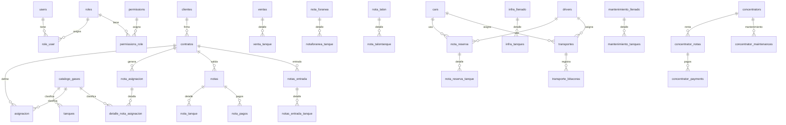

# Modelo de Datos

Fecha de analisis: 2026-05-30

Este documento resume el modelo de datos detectado por lectura estatica de migraciones Laravel en `database/migrations` y modelos en `app/Models`, `app/User.php`, `app/Role.php` y `app/Permissions.php`. Debe usarse como base para redisenio/migracion, no como sustituto de validacion funcional con usuarios finales.

## Convenciones actuales

- La llave primaria principal es `id` autoincremental en casi todas las tablas.
- Varias relaciones existen de forma logica por `num_serie` contra `tanques.num_serie`, aunque no siempre tienen llave foranea declarada.
- Muchos campos `user_id` son auditoria logica, pero en la mayoria de migraciones no se declaran como FK hacia `users`.
- Los importes monetarios estan guardados como `float`, `double` o incluso `string`; para una migracion conviene normalizarlos a `decimal`.
- Algunas tablas usan nombres en singular (`asignacion`, `nota_tanque`) y otras en plural (`clientes`, `tanques`).
- Existe el typo historico `insidencia` en tablas de detalle de notas no contractuales; debe mapearse con cuidado si se renombra a `incidencia`.

## Dominios principales

| Dominio | Tablas |
| --- | --- |
| Seguridad | `users`, `roles`, `permissions`, `role_user`, `permissions_role`, `password_resets`, `failed_jobs` |
| Clientes | `clientes`, `clientes_sin_contrato` |
| Catalogos | `catalogo_gases`, `config_sistem`, `datos_empresa` |
| Tanques | `tanques`, `tanques_reportados` |
| Contratos y asignaciones | `contratos`, `asignacion`, `nota_asignacion`, `detalle_nota_asignacion`, `agreements` |
| Notas contrato | `notas`, `nota_tanque`, `notas_entrada`, `notas_entrada_tanque`, `nota_pagos` |
| Notas mostrador/foranea/talon/reserva | `ventas`, `venta_tanque`, `nota_foranea`, `notaforanea_tanque`, `nota_talon`, `nota_talontanque`, `nota_reserva`, `nota_reserva_tanque` |
| Infra y mantenimiento | `infra_llenado`, `infra_tanques`, `mantenimiento_llenado`, `mantenimiento_tanques` |
| Transporte | `cars`, `drivers`, `transportes`, `transporte_bitacoras` |
| Concentradores | `concentrators`, `concentrator_notas`, `concentrator_payments`, `concentrator_maintenances` |

## Relaciones principales

Nota: el diagrama muestra relaciones funcionales. Algunas no estan declaradas como FK en la base actual.

## Diccionario de tablas

### Seguridad

#### `users`
Usuarios del sistema.

| Campo | Tipo actual | Notas |
| --- | --- | --- |
| `id` | bigint PK | Identificador |
| `name` | string | Nombre |
| `email` | string unique | Correo unico |
| `email_verified_at` | timestamp nullable | Verificacion de email |
| `password` | string | Hash de password |
| `remember_token` | string nullable | Token Laravel |
| `created_at`, `updated_at` | timestamp | Auditoria Laravel |

#### `roles`
Roles operativos.

| Campo | Tipo actual | Notas |
| --- | --- | --- |
| `id` | bigint PK | Identificador |
| `name` | string unique | Nombre |
| `slug` | string unique | Clave interna |
| `description` | text nullable | Descripcion |
| `created_at`, `updated_at` | timestamp | Auditoria Laravel |

#### `permissions`
Permisos por accion/modulo.

| Campo | Tipo actual | Notas |
| --- | --- | --- |
| `id` | bigint PK | Identificador |
| `name` | string unique | Nombre |
| `slug` | string unique | Clave usada en validaciones |
| `description` | text nullable | Descripcion |
| `created_at`, `updated_at` | timestamp | Auditoria Laravel |

#### `role_user`
Relacion muchos a muchos entre usuarios y roles.

| Campo | Tipo actual | Notas |
| --- | --- | --- |
| `id` | bigint PK | Identificador |
| `role_id` | FK `roles.id` | `onDelete restrict` |
| `user_id` | FK `users.id` | `onDelete restrict` |
| `created_at`, `updated_at` | timestamp | Auditoria Laravel |

#### `permissions_role`
Relacion muchos a muchos entre roles y permisos.

| Campo | Tipo actual | Notas |
| --- | --- | --- |
| `id` | bigint PK | Identificador |
| `role_id` | FK `roles.id` | `onDelete cascade` |
| `permissions_id` | FK `permissions.id` | `onDelete cascade`; nombre no estandar |
| `created_at`, `updated_at` | timestamp | Auditoria Laravel |

#### `password_resets`
Tokens de recuperacion de password.

| Campo | Tipo actual | Notas |
| --- | --- | --- |
| `email` | string index | Correo |
| `token` | string | Token |
| `created_at` | timestamp nullable | Fecha de creacion |

#### `failed_jobs`
Jobs fallidos de Laravel.

| Campo | Tipo actual | Notas |
| --- | --- | --- |
| `id` | bigint PK | Identificador |
| `connection` | text | Conexion |
| `queue` | text | Cola |
| `payload` | longText | Payload |
| `exception` | longText | Excepcion |
| `failed_at` | timestamp | Default current |

### Clientes y catalogos

#### `clientes`
Clientes con contrato.

| Campo | Tipo actual | Notas |
| --- | --- | --- |
| `id` | bigint PK | Identificador |
| `apPaterno`, `apMaterno`, `nombre` | string nullable | Datos persona fisica |
| `empresa` | string nullable | Datos persona moral |
| `rfc` | string | RFC |
| `email` | string | Correo |
| `telefono`, `telefonorespaldo` | string | Contacto |
| `direccion`, `referencia` | string nullable | Direccion |
| `estatus` | string | Estado operativo |
| `created_at`, `updated_at` | timestamp | Auditoria Laravel |

#### `clientes_sin_contrato`
Clientes usados en notas sin contrato y concentradores.

| Campo | Tipo actual | Notas |
| --- | --- | --- |
| `id` | bigint PK | Identificador |
| `nombre` | string | Nombre completo o razon social |
| `telefono`, `email`, `direccion` | string nullable | Contacto |
| `rfc`, `cfdi`, `direccion_factura` | string nullable | Facturacion |
| `direccion_envio`, `referencia_envio`, `link_ubicacion_envio` | string nullable | Envio |
| `precio_envio` | float nullable default 0 | Importe de envio |
| `created_at`, `updated_at` | timestamp | Auditoria Laravel |

#### `catalogo_gases`
Catalogo base de gases.

| Campo | Tipo actual | Notas |
| --- | --- | --- |
| `id` | bigint PK | Identificador |
| `nombre` | string | Nombre del gas |
| `abreviatura` | string | Clave corta |

#### `config_sistem`
Parametros simples clave/valor.

| Campo | Tipo actual | Notas |
| --- | --- | --- |
| `id` | bigint PK | Identificador |
| `nombre` | string | Clave |
| `valor` | string | Valor |
| `created_at`, `updated_at` | timestamp | Auditoria Laravel |

#### `datos_empresa`
Datos fiscales, contacto y cuentas bancarias de la empresa.

| Campo | Tipo actual | Notas |
| --- | --- | --- |
| `id` | bigint PK | Identificador |
| `email`, `rfc`, `direccion` | string nullable | Datos generales |
| `telefono1`, `telefono2`, `telefono3` | string nullable | Telefonos |
| `num_cuenta1`, `clave1`, `banco1`, `titular1` | string nullable | Cuenta bancaria 1 |
| `num_cuenta2`, `clave2`, `banco2`, `titular2` | string nullable | Cuenta bancaria 2 |

### Tanques

#### `tanques`
Inventario principal de cilindros/tanques.

| Campo | Tipo actual | Notas |
| --- | --- | --- |
| `id` | bigint PK | Identificador |
| `num_serie` | string unique | Serie del tanque |
| `ph` | string | Fecha/prueba hidrostatica |
| `capacidad` | string | Capacidad actual como texto |
| `material` | string | Material |
| `fabricante` | string | Fabricante |
| `tipo_gas` | FK `catalogo_gases.id` | `onDelete restrict` |
| `tipo_tanque` | string | Tipo de cilindro |
| `estatus` | string | Estado operativo del tanque |
| `user_id` | bigint nullable | Auditoria logica |
| `created_at`, `updated_at` | timestamp | Auditoria Laravel |

#### `tanques_reportados`
Tanques marcados como reportados.

| Campo | Tipo actual | Notas |
| --- | --- | --- |
| `id` | bigint PK | Identificador |
| `num_serie` | FK `tanques.num_serie`, unique | Reporte por serie |
| `observaciones` | string | Motivo/detalle |
| `created_at`, `updated_at` | timestamp | Auditoria Laravel |

### Contratos y asignaciones

#### `contratos`
Contrato de renta/servicio para un cliente.

| Campo | Tipo actual | Notas |
| --- | --- | --- |
| `id` | bigint PK | Identificador |
| `cliente_id` | FK `clientes.id` | `onDelete cascade` |
| `tipo_contrato` | string | Tipo de contrato |
| `precio_renta` | string nullable | Importe actual como texto |
| `frecuency` | string nullable | Frecuencia |
| `nombre_comercial` | string nullable | Nombre comercial |
| `reguladores` | integer nullable default 0 | Cantidad |
| `modelo_regulador` | string nullable | Modelo |
| `precio_transporte` | double nullable default 0 | Costo transporte |
| `direccion`, `referencia`, `calle1`, `calle2`, `link_ubicacion` | string nullable | Direccion/envio |
| `observaciones` | string nullable | Observaciones |
| `nombre_solidaria`, `telefono_solidaria`, `email_solidaria`, `direccion_solidaria` | string nullable | Obligado solidario |
| `created_at`, `updated_at` | timestamp | Auditoria Laravel |

Restriccion unica: `cliente_id` + `tipo_contrato`.

#### `asignacion`
Asignaciones vigentes de cilindros por contrato.

| Campo | Tipo actual | Notas |
| --- | --- | --- |
| `id` | bigint PK | Identificador |
| `contratos_id` | FK `contratos.id` | `onDelete cascade`; nombre no estandar |
| `cilindros` | integer | Cantidad asignada |
| `tipo_gas` | FK `catalogo_gases.id` | Gas asignado |
| `tipo_tanque` | string | Tipo de tanque |
| `material` | string | Material |
| `precio_unitario` | float | Precio |
| `unidad_medida` | string | Unidad |
| `capacidad` | float | Capacidad |
| `created_at`, `updated_at` | timestamp | Auditoria Laravel |

#### `nota_asignacion`
Documento historico de aumento, disminucion o inicio de contrato.

| Campo | Tipo actual | Notas |
| --- | --- | --- |
| `id` | bigint PK | Identificador |
| `contrato_id` | FK `contratos.id` | `onDelete cascade` |
| `fecha` | date | Fecha |
| `incidencia` | enum | `AUMENTO`, `DISMINUCION`, `INICIO-CONTRATO` |
| `user_id` | bigint nullable | Auditoria logica |
| `created_at`, `updated_at` | timestamp | Auditoria Laravel |

#### `detalle_nota_asignacion`
Detalle de cada nota de asignacion.

| Campo | Tipo actual | Notas |
| --- | --- | --- |
| `id` | bigint PK | Identificador |
| `nota_asignacion_id` | FK `nota_asignacion.id` | `onDelete cascade` |
| `cilindros` | integer | Cantidad |
| `tipo_gas` | FK `catalogo_gases.id` | Gas |
| `tipo_tanque`, `material`, `unidad_medida` | string | Clasificacion |
| `capacidad` | float | Capacidad |
| `deposito_garantia` | float | Deposito |
| `created_at`, `updated_at` | timestamp | Auditoria Laravel |

#### `agreements`
Tabla placeholder sin columnas de negocio detectadas.

| Campo | Tipo actual | Notas |
| --- | --- | --- |
| `id` | bigint PK | Identificador |
| `created_at`, `updated_at` | timestamp | Auditoria Laravel |

### Notas contrato

#### `notas`
Notas de salida de contrato.

| Campo | Tipo actual | Notas |
| --- | --- | --- |
| `id` | bigint PK | Identificador |
| `contrato_id` | FK `contratos.id` | Contrato |
| `fecha` | date | Fecha de nota |
| `envio` | string | Datos/importe de envio |
| `subtotal`, `iva_general`, `total`, `primer_pago` | float | Importes |
| `metodo_pago` | string | Metodo |
| `pago_cubierto` | boolean | Pagada o adeudo |
| `observaciones` | string nullable | Observaciones |
| `user_id` | bigint nullable | Auditoria logica |
| `estatus` | enum | `ACTIVA`, `CANCELADA` |
| `created_at`, `updated_at` | timestamp | Auditoria Laravel |

#### `nota_tanque`
Detalle de tanques en salida de contrato.

| Campo | Tipo actual | Notas |
| --- | --- | --- |
| `id` | bigint PK | Identificador |
| `nota_id` | FK `notas.id` | Nota salida |
| `num_serie` | string | Serie del tanque; relacion logica con `tanques` |
| `cantidad` | float nullable | Cantidad |
| `unidad_medida` | string nullable | Unidad |
| `precio_unitario` | double nullable | Precio |
| `tapa_tanque` | enum | `SI`, `NO` |
| `iva_particular`, `importe` | float nullable | Importes |
| `estatus` | enum | `PENDIENTE`, `DEVUELTO`, `CAMBIADO` |
| `created_at`, `updated_at` | timestamp | Auditoria Laravel |

#### `nota_pagos`
Pagos parciales de notas de contrato.

| Campo | Tipo actual | Notas |
| --- | --- | --- |
| `id` | bigint PK | Identificador |
| `nota_id` | FK `notas.id` | Nota salida |
| `monto_pago` | float | Monto |
| `metodo_pago` | string | Metodo |
| `user_id` | bigint nullable | Auditoria logica |
| `created_at`, `updated_at` | timestamp | Auditoria Laravel |

#### `notas_entrada`
Notas de devolucion/entrada de contrato.

| Campo | Tipo actual | Notas |
| --- | --- | --- |
| `id` | bigint PK | Identificador |
| `contrato_id` | FK `contratos.id` | Contrato |
| `metodo_pago` | string nullable | Metodo |
| `recargos` | double nullable default 0 | Recargos |
| `observaciones` | string nullable | Observaciones |
| `user_id` | bigint nullable | Auditoria logica |
| `estatus` | enum | `ACTIVA`, `CANCELADA` |
| `created_at`, `updated_at` | timestamp | Auditoria Laravel |

#### `notas_entrada_tanque`
Detalle de tanques devueltos en entrada de contrato.

| Campo | Tipo actual | Notas |
| --- | --- | --- |
| `id` | bigint PK | Identificador |
| `nota_id` | FK `notas_entrada.id` | Nota entrada |
| `num_serie` | string | Serie del tanque |
| `tapa_tanque` | enum | `SI`, `NO` |
| `intercambio` | string | Marca si hubo intercambio |
| `created_at`, `updated_at` | timestamp | Auditoria Laravel |

### Notas sin contrato

#### `ventas`
Notas exporadicas/de mostrador.

| Campo | Tipo actual | Notas |
| --- | --- | --- |
| `id` | bigint PK | Identificador |
| `num_cliente` | integer nullable | Referencia logica a cliente sin contrato |
| `nombre`, `telefono`, `email`, `direccion` | string nullable | Datos copiados del cliente |
| `rfc`, `cfdi`, `direccion_factura` | string nullable | Facturacion |
| `direccion_envio`, `referencia_envio`, `link_ubicacion_envio` | string nullable | Envio |
| `precio_envio` | float nullable default 0 | Importe de envio |
| `subtotal`, `iva_general`, `total` | float | Importes |
| `metodo_pago` | string nullable | Metodo |
| `fecha` | date | Fecha |
| `estatus` | enum | `ACTIVA`, `CANCELADA` |
| `user_id` | bigint nullable | Auditoria logica |
| `observaciones` | string nullable | Observaciones |
| `created_at`, `updated_at` | timestamp | Auditoria Laravel |

#### `venta_tanque`
Detalle de tanques de notas exporadicas.

| Campo | Tipo actual | Notas |
| --- | --- | --- |
| `id` | bigint PK | Identificador |
| `venta_id` | FK `ventas.id` | Nota exporadica |
| `num_serie` | string | Serie |
| `cantidad` | float nullable | Cantidad |
| `unidad_medida` | string nullable | Unidad |
| `tapa_tanque` | enum nullable | `SI`, `NO` |
| `iva_particular`, `importe` | float nullable | Importes |
| `insidencia` | enum | `ENTRADA`, `SALIDA` |
| `created_at`, `updated_at` | timestamp | Auditoria Laravel |

#### `nota_foranea`
Nota foranea.

| Campo | Tipo actual | Notas |
| --- | --- | --- |
| `id` | bigint PK | Identificador |
| `num_cliente` | integer nullable | Referencia logica a cliente sin contrato |
| `nombre`, `telefono`, `email`, `direccion` | string nullable | Datos de cliente |
| `rfc`, `cfdi`, `direccion_factura` | string nullable | Facturacion |
| `direccion_envio`, `referencia_envio`, `link_ubicacion_envio` | string nullable | Envio |
| `precio_envio` | float nullable default 0 | Importe de envio |
| `subtotal`, `iva_general`, `total` | float | Importes |
| `pago_cubierto` | boolean default true | Pago |
| `tanques_devueltos` | boolean default false | Devolucion completa |
| `metodo_pago` | string nullable | Metodo |
| `fecha` | date | Fecha |
| `user_id` | bigint nullable | Auditoria logica |
| `observaciones` | string nullable | Observaciones |
| `created_at`, `updated_at` | timestamp | Auditoria Laravel |

#### `notaforanea_tanque`
Detalle de nota foranea.

| Campo | Tipo actual | Notas |
| --- | --- | --- |
| `id` | bigint PK | Identificador |
| `nota_foranea_id` | FK `nota_foranea.id` | Nota foranea |
| `num_serie` | string | Serie |
| `cantidad` | float nullable | Cantidad |
| `unidad_medida` | string nullable | Unidad |
| `precio_unitario` | double nullable | Precio |
| `tapa_tanque` | enum nullable | `SI`, `NO` |
| `iva_particular`, `importe` | float nullable | Importes |
| `insidencia` | enum | `ENTRADA`, `SALIDA` |
| `created_at`, `updated_at` | timestamp | Auditoria Laravel |

#### `nota_talon`
Nota talon.

| Campo | Tipo actual | Notas |
| --- | --- | --- |
| `id` | bigint PK | Identificador |
| `num_cliente` | integer nullable | Referencia logica a cliente sin contrato |
| `nombre`, `telefono`, `email`, `direccion` | string nullable | Datos de cliente |
| `rfc`, `cfdi`, `direccion_factura` | string nullable | Facturacion |
| `direccion_envio`, `referencia_envio`, `link_ubicacion_envio` | string nullable | Envio |
| `precio_envio` | float nullable default 0 | Importe de envio |
| `pendiente` | boolean default true | Pendiente de completar |
| `subtotal`, `iva_general`, `total` | float default 0 | Importes |
| `metodo_pago` | string nullable | Metodo |
| `fecha` | date | Fecha |
| `user_id` | bigint nullable | Auditoria logica |
| `observaciones` | string nullable | Observaciones |
| `created_at`, `updated_at` | timestamp | Auditoria Laravel |

#### `nota_talontanque`
Detalle de nota talon.

| Campo | Tipo actual | Notas |
| --- | --- | --- |
| `id` | bigint PK | Identificador |
| `nota_talon_id` | FK `nota_talon.id` | Nota talon |
| `num_serie` | string | Serie |
| `cantidad` | float nullable | Cantidad |
| `unidad_medida` | string nullable | Unidad |
| `precio_unitario` | double nullable | Precio |
| `tapa_tanque` | enum nullable | `SI`, `NO` |
| `iva_particular`, `importe` | float nullable | Importes |
| `insidencia` | enum | `ENTRADA`, `SALIDA` |
| `created_at`, `updated_at` | timestamp | Auditoria Laravel |

#### `nota_reserva`
Movimiento de reserva/transporte de tanques.

| Campo | Tipo actual | Notas |
| --- | --- | --- |
| `id` | bigint PK | Identificador |
| `user_id` | bigint nullable | Auditoria logica |
| `incidencia` | enum | `ENTRADA`, `SALIDA` |
| `driver_id` | FK `drivers.id` nullable | `onDelete SET NULL` |
| `car_id` | FK `cars.id` nullable | `onDelete SET NULL` |
| `created_at`, `updated_at` | timestamp | Auditoria Laravel |

#### `nota_reserva_tanque`
Detalle de tanques de reserva.

| Campo | Tipo actual | Notas |
| --- | --- | --- |
| `id` | bigint PK | Identificador |
| `nota_id` | FK `nota_reserva.id` | Nota reserva |
| `num_serie` | string | Serie |
| `created_at`, `updated_at` | timestamp | Auditoria Laravel |

### Infra y mantenimiento

#### `infra_llenado`
Cabecera de envio/recepcion de llenado infra.

| Campo | Tipo actual | Notas |
| --- | --- | --- |
| `id` | bigint PK | Identificador |
| `cantidad_salida` | integer | Cantidad enviada |
| `cantidad_entrada` | integer nullable | Cantidad recibida |
| `cantidad_diferencia` | integer default 0 | Diferencia |
| `pendiente` | boolean nullable default true | Estado |
| `observaciones` | string nullable | Observaciones |
| `user_id` | bigint nullable | Auditoria logica |
| `created_at`, `updated_at` | timestamp | Auditoria Laravel |

#### `infra_tanques`
Detalle de tanques en infra.

| Campo | Tipo actual | Notas |
| --- | --- | --- |
| `id` | bigint PK | Identificador |
| `infrallenado_id` | FK `infra_llenado.id` | `onDelete cascade` |
| `num_serie` | string | Serie |
| `incidencia` | enum | `ENTRADA`, `SALIDA` |
| `created_at`, `updated_at` | timestamp | Auditoria Laravel |

#### `mantenimiento_llenado`
Cabecera de mantenimiento de tanques.

| Campo | Tipo actual | Notas |
| --- | --- | --- |
| `id` | bigint PK | Identificador |
| `fecha` | date | Fecha |
| `cantidad` | integer | Cantidad |
| `pendiente` | boolean default true | Estado |
| `created_at`, `updated_at` | timestamp | Auditoria Laravel |

#### `mantenimiento_tanques`
Detalle de tanques en mantenimiento.

| Campo | Tipo actual | Notas |
| --- | --- | --- |
| `id` | bigint PK | Identificador |
| `mantenimientollenado_id` | FK `mantenimiento_llenado.id` | `onDelete cascade` |
| `num_serie` | string | Serie |
| `folio_talon` | string nullable | Folio externo |
| `incidencia` | enum | `ENTRADA`, `SALIDA` |
| `user_id` | bigint nullable | Auditoria logica |
| `created_at`, `updated_at` | timestamp | Auditoria Laravel |

### Transporte

#### `cars`
Vehiculos.

| Campo | Tipo actual | Notas |
| --- | --- | --- |
| `id` | bigint PK | Identificador |
| `nombre`, `modelo`, `marca`, `placa` | string nullable | Datos del vehiculo |
| `created_at`, `updated_at` | timestamp | Auditoria Laravel |

#### `drivers`
Choferes.

| Campo | Tipo actual | Notas |
| --- | --- | --- |
| `id` | bigint PK | Identificador |
| `nombre`, `apellido` | string | Nombre |
| `licencia_tipo`, `licencia_numero` | string | Licencia |
| `created_at`, `updated_at` | timestamp | Auditoria Laravel |

#### `transportes`
Cabecera de transporte/bitacora diaria.

| Campo | Tipo actual | Notas |
| --- | --- | --- |
| `id` | bigint PK | Identificador |
| `fecha` | string | Fecha como texto |
| `car_id` | FK `cars.id` nullable | `onDelete SET NULL` |
| `driver_id` | FK `drivers.id` nullable | `onDelete SET NULL` |
| `kilometraje_inicial`, `kilometraje_final` | integer nullable | Kilometraje |
| `envases`, `acomuladores`, `observaciones` | string nullable | Datos operativos |
| `created_at`, `updated_at` | timestamp | Auditoria Laravel |

#### `transporte_bitacoras`
Detalle de rutas/cargas en transporte.

| Campo | Tipo actual | Notas |
| --- | --- | --- |
| `id` | bigint PK | Identificador |
| `transporte_id` | FK `transportes.id` nullable | `onDelete SET NULL` |
| `lugar_salida`, `lugar_llegada` | string | Ruta |
| `hora_salida`, `hora_entrada` | time | Horarios |
| `descarga`, `carga`, `total` | string | Cantidades como texto |
| `observaciones` | string nullable | Observaciones |
| `created_at`, `updated_at` | timestamp | Auditoria Laravel |

### Concentradores

#### `concentrators`
Inventario de concentradores.

| Campo | Tipo actual | Notas |
| --- | --- | --- |
| `id` | bigint PK | Identificador |
| `serial_number` | string unique | Numero de serie |
| `brand` | string | Marca |
| `work_hours` | string | Horas de trabajo como texto |
| `capacity` | float | Capacidad |
| `status` | enum | `ALMACEN`, `EN RENTA`, `MANTENIMIENTO` |
| `description` | string nullable | Descripcion |
| `created_at`, `updated_at` | timestamp | Auditoria Laravel |

#### `concentrator_notas`
Notas/rentas de concentradores.

| Campo | Tipo actual | Notas |
| --- | --- | --- |
| `id` | bigint PK | Identificador |
| `num_client` | integer nullable | Referencia logica a cliente sin contrato |
| `name`, `phone_number`, `email`, `address` | string nullable | Cliente |
| `rfc`, `cfdi`, `address_facture` | string nullable | Facturacion |
| `status` | enum default `ABIERTA` | `ABIERTA`, `CERRADA` |
| `concentrator_id` | FK `concentrators.id` | `onDelete restrict` |
| `hours_works_consumed` | integer nullable | Horas consumidas |
| `return_concentrator` | dateTime nullable | Fecha de devolucion |
| `observations` | string nullable | Observaciones |
| `user_id` | bigint nullable | Auditoria logica |
| `created_at`, `updated_at` | timestamp | Auditoria Laravel |

#### `concentrator_payments`
Pagos y periodos de renta de concentradores.

| Campo | Tipo actual | Notas |
| --- | --- | --- |
| `id` | bigint PK | Identificador |
| `note_id` | FK `concentrator_notas.id` | `onDelete cascade` |
| `day`, `week`, `mount` | integer | Cantidades de periodo |
| `price_day`, `price_week`, `price_mount` | float | Precios |
| `deposit_garanty` | float nullable default 0 | Deposito |
| `date_start`, `date_end` | date | Periodo |
| `work_hours_output` | float nullable | Horas de salida |
| `shipping_address`, `shipping_reference`, `link_location` | string nullable | Envio |
| `shipping_price` | float nullable default 0 | Costo envio |
| `total` | float | Total |
| `payment_method` | string nullable | Metodo |
| `status` | enum | `PAGADO`, `ADEUDA` |
| `observations` | string nullable | Observaciones |
| `user_id` | bigint nullable | Auditoria logica |
| `created_at`, `updated_at` | timestamp | Auditoria Laravel |

#### `concentrator_maintenances`
Mantenimientos de concentradores.

| Campo | Tipo actual | Notas |
| --- | --- | --- |
| `id` | bigint PK | Identificador |
| `concentrator_id` | FK `concentrators.id` | `onDelete restrict` |
| `serial_number` | string | Serie copiada |
| `work_hours` | string nullable | Horas |
| `status` | enum | `OK`, `PENDIENTE` |
| `observations` | string nullable | Observaciones |
| `user_id` | bigint nullable | Auditoria logica |
| `date_return` | dateTime nullable | Fecha de retorno |
| `created_at`, `updated_at` | timestamp | Auditoria Laravel |

## Estados detectados

### Tanques

- `VACIO-ALMACEN`
- `LLENO-ALMACEN`
- `ENTREGADO-CLIENTE`
- `BAJA-TANQUE`
- `TANQUE-REPORTADO`
- `TANQUE-CAMBIADO`
- `VENTA-EXPORADICA`
- `VENTA-FORANEA`
- `VENTA-TALON`
- `TANQUE-RESERVA`
- `INFRA`
- `MANTENIMIENTO`

### Notas y movimientos

- `notas.estatus`: `ACTIVA`, `CANCELADA`
- `notas_entrada.estatus`: `ACTIVA`, `CANCELADA`
- `nota_tanque.estatus`: `PENDIENTE`, `DEVUELTO`, `CAMBIADO`
- `venta_tanque.insidencia`: `ENTRADA`, `SALIDA`
- `notaforanea_tanque.insidencia`: `ENTRADA`, `SALIDA`
- `nota_talontanque.insidencia`: `ENTRADA`, `SALIDA`
- `nota_reserva.incidencia`: `ENTRADA`, `SALIDA`
- `infra_tanques.incidencia`: `ENTRADA`, `SALIDA`
- `mantenimiento_tanques.incidencia`: `ENTRADA`, `SALIDA`
- `nota_asignacion.incidencia`: `AUMENTO`, `DISMINUCION`, `INICIO-CONTRATO`

### Concentradores

- `concentrators.status`: `ALMACEN`, `EN RENTA`, `MANTENIMIENTO`
- `concentrator_notas.status`: `ABIERTA`, `CERRADA`
- `concentrator_payments.status`: `PAGADO`, `ADEUDA`
- `concentrator_maintenances.status`: `OK`, `PENDIENTE`

## Observaciones para el modelo destino

- Normalizar importes a `decimal(12,2)` o precision definida por negocio.
- Convertir fechas almacenadas como `string` a `date` o `datetime`, especialmente `transportes.fecha` y `tanques.ph`.
- Definir una relacion formal para tanques por `tanque_id` en detalles de notas, o conservar `num_serie` como snapshot si se requiere historico inmutable.
- Separar snapshots de cliente en notas sin contrato de la entidad `clientes_sin_contrato`; actualmente se copia informacion del cliente a cada nota.
- Renombrar `permissions_role.permissions_id` a `permission_id` en el modelo destino si se redisenia.
- Unificar `contratos_id` en `asignacion` a `contrato_id` si se redisenia.
- Corregir `insidencia` a `incidencia` solo con mapeo explicito para no romper migracion historica.
- Definir catalogos controlados para estados de tanques, tipos de contrato, tipos de tanque, material, unidad de medida y metodos de pago.
- Agregar FKs reales para campos `user_id` donde aplique auditoria.
- Evaluar indices para consultas por `num_serie`, `estatus`, `fecha`, `contrato_id`, `cliente_id`, `user_id` y estados de pago.

## Orden sugerido de migracion de datos

1. Seguridad: `users`, `roles`, `permissions`, pivotes.
2. Catalogos y configuracion: `catalogo_gases`, `datos_empresa`, `config_sistem`.
3. Clientes: `clientes`, `clientes_sin_contrato`.
4. Inventario: `tanques`, `tanques_reportados`.
5. Contratos: `contratos`, `asignacion`, `nota_asignacion`, `detalle_nota_asignacion`.
6. Notas contrato: `notas`, `nota_tanque`, `nota_pagos`, `notas_entrada`, `notas_entrada_tanque`.
7. Notas sin contrato: `ventas`, `venta_tanque`, `nota_foranea`, `notaforanea_tanque`, `nota_talon`, `nota_talontanque`, `nota_reserva`, `nota_reserva_tanque`.
8. Infra y mantenimiento: `infra_llenado`, `infra_tanques`, `mantenimiento_llenado`, `mantenimiento_tanques`.
9. Transporte: `cars`, `drivers`, `transportes`, `transporte_bitacoras`.
10. Concentradores: `concentrators`, `concentrator_notas`, `concentrator_payments`, `concentrator_maintenances`.

